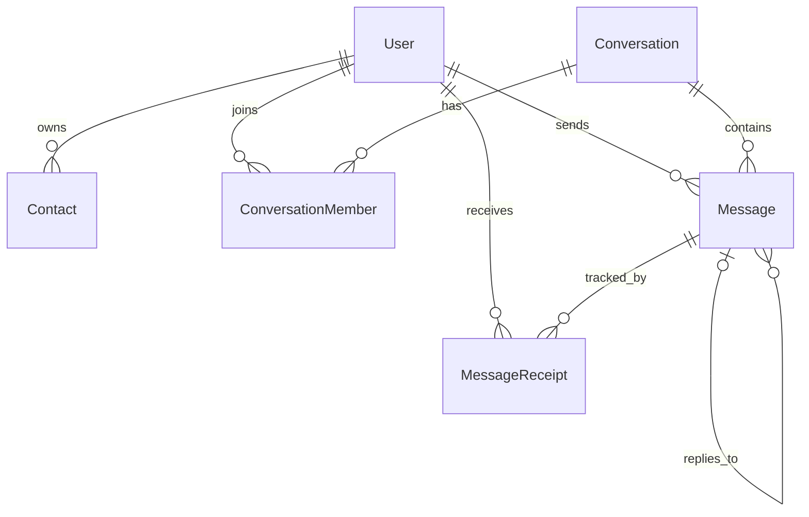

# Database Architecture

This document describes the implemented relational database schema for the messaging platform. The database uses SQLite for development, accessed asynchronously via SQLAlchemy 2.x and `aiosqlite`, with schema migrations managed by Alembic.

## Entity Relationship Diagram

## Core Entities

### User (`users`)
Represents registered users of the platform.
- `id` (UUID, PK)
- `username` (String, Unique, Indexed)
- `phone` (String, Unique, Indexed, Nullable)
- `display_name` (String, Nullable)
- `avatar_url` (String, Nullable)
- `password_hash` (String, bcrypt hashed)
- `is_online` (Boolean)
- `last_seen` (DateTime, Nullable)
- `created_at` (DateTime, default: `func.now()`)
- `updated_at` (DateTime, updated via `func.now()`)

### Contact (`contacts`)
Represents unidirectional contact relationships.
- `id` (UUID, PK)
- `user_id` (UUID, FK to users, Indexed, CASCADE on delete)
- `contact_user_id` (UUID, FK to users, Indexed, CASCADE on delete)
- `created_at` (DateTime)
- **Constraints**: 
  - `UniqueConstraint("user_id", "contact_user_id")` prevents duplicate entries.
  - `CheckConstraint("user_id != contact_user_id")` prevents self-contacts.

### Conversation (`conversations`)
Represents both Direct and Group chats dynamically via its type.
- `id` (UUID, PK)
- `type` (Enum: `DIRECT`, `GROUP`)
- `name` (String, Nullable)
- `avatar_url` (String, Nullable)
- `created_by_id` (UUID, FK to users, SET NULL on delete, Nullable)
- `created_at` (DateTime)
- `updated_at` (DateTime)

### ConversationMember (`conversation_members`)
Junction table linking Users to Conversations with role management.
- `id` (UUID, PK)
- `conversation_id` (UUID, FK to conversations, Indexed, CASCADE on delete)
- `user_id` (UUID, FK to users, Indexed, CASCADE on delete)
- `role` (Enum: `MEMBER`, `ADMIN`)
- `joined_at` (DateTime)
- `left_at` (DateTime, Nullable, for tombstones)
- **Constraints**: `UniqueConstraint("conversation_id", "user_id")` ensures a user cannot join the same conversation multiple times simultaneously.

### Message (`messages`)
Stores message content and ties it to a conversation and sender.
- `id` (UUID, PK)
- `conversation_id` (UUID, FK to conversations, Indexed, CASCADE on delete)
- `sender_id` (UUID, FK to users, Indexed, SET NULL on delete)
- `content` (Text)
- `message_type` (Enum: `TEXT`, `IMAGE`, `FILE`, `SYSTEM`)
- `reply_to_message_id` (UUID, FK to messages, SET NULL on delete, Nullable)
- `created_at` (DateTime)
- `updated_at` (DateTime)
- **Design Note**: `reply_to_message_id` is a self-referencing nullable foreign key supporting message threads.

### MessageReceipt (`message_receipts`)
Tracks the delivery and read status of messages on a per-recipient basis.
- `id` (UUID, PK)
- `message_id` (UUID, FK to messages, Indexed, CASCADE on delete)
- `user_id` (UUID, FK to users, Indexed, CASCADE on delete)
- `status` (Enum: `SENT`, `DELIVERED`, `READ`)
- `timestamp` (DateTime)
- **Constraints**: `UniqueConstraint("message_id", "user_id")` ensures each recipient has only one tracked status per message.

---

## Important Design Decisions

### Conversation Type Design (No Separate Group Table)
Rather than splitting `DirectMessage` and `GroupMessage` tables, we utilize a single `Conversation` table alongside `ConversationMember` associations. This polymorphism allows our messaging engine, receipt tracking, and WebSocket broadcasters to operate uniformly across any conversation size.

### Separate Message Receipts
Receipt statuses (`DELIVERED`, `READ`) are not stored as columns on the `Message` table. In group chats, a single message can have differing statuses for each recipient. Thus, `MessageReceipt` acts as a junction entity tracking per-user state against a specific message.

### Cascade Behavior
- **Conversation Deletion**: `CASCADE` removes all associated `ConversationMember` and `Message` rows.
- **User Deletion**: 
  - `ConversationMember` and `MessageReceipt` are `CASCADE` removed.
  - `Message.sender_id` uses `SET NULL` so historical conversation messages aren't inexplicably deleted for other active participants if a single sender deletes their account.

### Timestamps
We utilize database-native `func.now()` defaults for `created_at` and `onupdate=func.now()` for `updated_at`. This pushes timestamp resolution to the database layer, guaranteeing consistency regardless of application timezone drift.

### Seed Data Strategy
The `backend/seed.py` utility deterministically generates core users (Alice, Bob, Charlie, etc.), establishes direct and group conversations, and inserts representative messages. The script is designed to be fully idempotent (rerunning it safely bypasses creation if the entities already exist via lookups).
